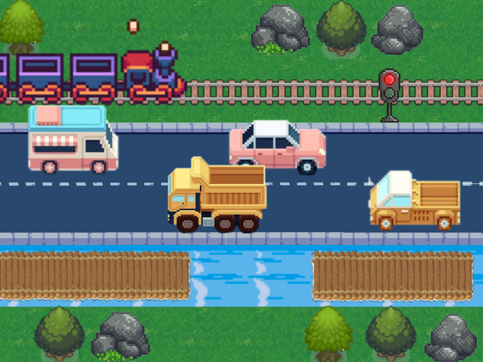

# Crossy Road

An arcade-style 2D game inspired by Crossy Road, built with Python and
Pygame. The player crosses procedurally generated blocks of grass, roads,
rivers and railway tracks while avoiding moving obstacles.




## Features

- Grid-based player movement with keyboard controls
- Procedurally generated level sections
- Cars, trains and moving logs
- Water safety system with logs and lily pads
- Collision detection and death animations
- Animated player sprites
- Collectible coins and persistent high score
- Character skins and visual themes
- Background music, sound effects and pause menu
- Unit tests for generation, spawning, movement and collisions

## Installation

### Requirements

- Python 3.10 or newer
- A system with a display and audio output

### Setup

From the project root:

```bash
python -m venv .venv
```

Activate the virtual environment:

```bash
# Windows PowerShell
.venv\Scripts\Activate.ps1

# macOS/Linux
source .venv/bin/activate
```

Install the dependencies:

```bash
python -m pip install -r requirements.txt
```

## Launch

Run the game from the project root:

```bash
python main.py
```

Starting the game from the project root is currently required because asset
paths are relative to that directory.

## Controls

| Action | Keys |
| --- | --- |
| Move up | `Z` or `Up Arrow` |
| Move down | `S` or `Down Arrow` |
| Move left | `Q` or `Left Arrow` |
| Move right | `D` or `Right Arrow` |
| Pause | Click the pause button |

## Tests

Run the pytest test suite with:

```bash
pytest -q tests/test_game.py tests/test_menu.py tests/test_paths.py
```

Run the legacy gameplay test launcher as well:

```bash
python execution_tests.py
```

Generate a coverage report:

```bash
pytest --cov=src --cov-report html tests/tests.py
```

The HTML report is generated in `htmlcov/index.html`.

## Project structure

```text
.
├── main.py                    # Application entry point
├── execution_tests.py         # Test launcher
├── requirements.txt           # Python dependencies
├── tests/
│   └── tests.py               # Automated gameplay logic tests
└── src/
    ├── game/
    │   ├── collision.py       # Collision and coin rules
    │   ├── constants.py       # Shared gameplay and display constants
    │   ├── generation.py      # Level and obstacle generation
    │   ├── objects.py         # Game objects and road state
    │   ├── player_movement.py # Player movement rules
    │   ├── play.py            # Game facade, Game state and frame orchestration
    │   ├── sound.py           # Sound effects
    │   └── spawn.py           # Moving object creation
    ├── graphics/
    │   ├── draw.py            # Rendering functions
    │   ├── animation.py       # Animations
    │   └── spritestheme.py    # Loaded sprites and themes
    ├── menu/
    │   ├── menu.py            # Main menu and character/theme selection
    │   ├── colors.py          # UI colors
    │   └── config.py          # Selected game configuration
    ├── static/                # Sprites, sounds, fonts and backgrounds
    └── high_score.txt         # Persisted high score
```

## Technical highlights

The project separates the main gameplay concerns into generation, movement,
collision and rendering modules. The `Game` class in `play.py` owns the
runtime state and coordinates one frame at a time. Its update, rendering,
keyboard input and event-handling responsibilities are split into dedicated
methods, while the logic-heavy modules can be tested independently without
launching the graphical application. The `play()` function remains as a small
public entry point for the menu.

## Known limitations

- Asset paths currently assume the game is launched from the project root.
- Audio initialization may require additional SDL configuration on some Linux
  systems.
- The game is designed for a fixed 1300x700 play area.

## Portfolio context

This project was developed during a bootcamp to practice Python, Pygame,
object-oriented design, real-time input handling, animation, procedural level
generation and automated testing.
